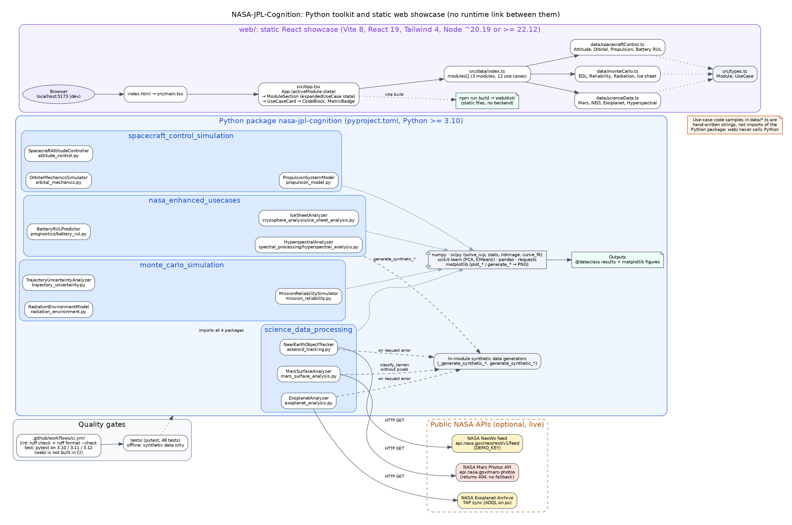

# Architecture

This repository holds two independent parts:

1. **A Python package** (`nasa-jpl-cognition`, defined in `pyproject.toml`) with four sub-packages of science, spacecraft, and Monte Carlo models.
2. **A static React showcase** in `web/` that presents 12 before/after use cases about those models.

The two parts do not talk to each other at runtime. The web UI renders hard-coded content from `web/src/data/*.ts`; its code samples are strings written for the page, not imports of the Python package. There is no server, database, or API in the repo.

Editable source: [`diagrams/architecture.dot`](diagrams/architecture.dot) (SVG: [`diagrams/architecture.svg`](diagrams/architecture.svg)).

## Python package

Each sub-package exports three classes from its `__init__.py`. Every class is a plain object with no shared base class or shared state: you build it, call a `run_*` / `analyze*` / `compute_*` / `predict_*` method that returns a `@dataclass` result, and optionally call a `plot_*` or `generate_*` method that draws a matplotlib figure and saves a PNG when given `output_path`.

| Sub-package | Class (module) | What it computes | External data |
|---|---|---|---|
| `science_data_processing` | `MarsSurfaceAnalyzer` (`mars_surface_analysis.py`) | Terrain classes and roughness from image gradients (`scipy.ndimage`) | NASA Mars Photos API; see [Known gaps](#known-gaps) |
| | `NearEarthObjectTracker` (`asteroid_tracking.py`) | Close-approach list, Palermo/Torino-style hazard estimate | NASA NeoWs `/feed` with `DEMO_KEY`; synthetic NEOs on request error |
| | `ExoplanetAnalyzer` (`exoplanet_analysis.py`) | Habitable zone, Earth Similarity Index, candidate list | NASA Exoplanet Archive TAP (`ps` table); synthetic planets on error |
| `spacecraft_control_simulation` | `SpacecraftAttitudeController` (`attitude_control.py`) | Quaternion attitude dynamics with PID and reaction wheels (`solve_ivp`) | None |
| | `OrbitalMechanicsSimulator` (`orbital_mechanics.py`) | Hohmann transfers, orbit propagation with J2, ground track | None |
| | `PropulsionSystemModel` (`propulsion_model.py`) | Rocket-equation propellant budgets and trade study over `STANDARD_CONFIGS` | None |
| `monte_carlo_simulation` | `TrajectoryUncertaintyAnalyzer` (`trajectory_uncertainty.py`) | Mars EDL and orbit-insertion dispersion, 99% landing ellipse | None |
| | `MissionReliabilitySimulator` (`mission_reliability.py`) | Subsystem failure sampling (Weibull/exponential), mission success rate | None |
| | `RadiationEnvironmentModel` (`radiation_environment.py`) | GCR, SPE, and trapped-belt dose, TID margin | None |
| `nasa_enhanced_usecases` | `BatteryRULPredictor` (`prognostics/battery_rul.py`) | Synthetic capacity fade and remaining useful life (`curve_fit`) | None |
| | `IceSheetAnalyzer` (`cryosphere_analysis/ice_sheet_analysis.py`) | Synthetic altimetry to mass change and sea-level contribution | None |
| | `HyperspectralAnalyzer` (`spectral_processing/hyperspectral_analysis.py`) | Synthetic cube, smoothing, PCA + KMeans, mineral matching | None |

Only the three `science_data_processing` classes use the network (`requests`). Every other model runs offline on generated or parametric data, so the test suite needs no network.

### Dependencies

Code imports `numpy`, `scipy`, `matplotlib`, `pandas`, `requests`, and `scikit-learn`. `MarsSurfaceAnalyzer.download_image` also imports `PIL` (installed with matplotlib). `pyproject.toml` additionally declares `astropy`, `h5py`, `plotly`, and `tqdm`, which no module imports.

## Web showcase (`web/`)

A single-page Vite 8 + React 19 + TypeScript app styled with Tailwind CSS 4 (via `@tailwindcss/vite`) and icons from `lucide-react`.

- `index.html` loads `src/main.tsx`, which mounts `App` in `StrictMode`.
- `src/App.tsx` holds every component. `App` keeps the selected module in `activeModule` state and renders three module cards; `ModuleSection` shows the selected module and keeps `expandedUseCase` state; `UseCaseCard` always shows the title and `MetricBadge` metrics, and on click expands to Situation, Before (code in `CodeBlock` + pain points), What Devin Built, After (code + improvements), and a "Value to NASA-JPL" paragraph. Only one use case per module is open at a time.
- `src/data/index.ts` exports `modules`, the registry of three `Module` objects (`src/types.ts`), each with four `UseCase` entries.

The web UI has three modules, not four. The `nasa_enhanced_usecases` models are shown inside them:

| Web module (`src/data/`) | Use cases |
|---|---|
| Science Data Processing (`scienceData.ts`) | Mars terrain, NEO hazard, exoplanet habitability, hyperspectral mineral mapping |
| Spacecraft Control (`spacecraftControl.ts`) | Attitude control, orbital mechanics, propulsion trade, battery RUL |
| Monte Carlo (`monteCarlo.ts`) | EDL trajectory, mission reliability, radiation, ice-sheet mass change |

There is no router, fetch call, or persisted state; reloading the page resets the selection. `npm run build` (`tsc -b && vite build`) writes static files to `web/dist/`.

## Tests and CI

- `tests/` has 48 pytest tests, one file per sub-package, all on synthetic data. Run with `PYTHONPATH=. MPLBACKEND=Agg pytest tests/ -v`.
- `.github/workflows/ci.yml` runs on pushes and PRs to `main`: a `lint` job (`ruff check .` and `ruff format --check .`, unpinned ruff on Python 3.11) and a `test` job (pytest on Python 3.10, 3.11, 3.12).
- CI does not install, lint, or build `web/`. Locally, `npm run build` and `npm run lint` in `web/` both pass.

## Known gaps

Found while writing this doc; not fixed here.

- The NASA Mars Photos API endpoint returns HTTP 404, and `MarsSurfaceAnalyzer.fetch_rover_images` returns an empty list on request errors (unlike the NEO and exoplanet fetchers, it has no synthetic fallback). The README Mars example therefore prints nothing. `classify_terrain` and `generate_terrain_map` still work on synthetic images.
- `TrajectoryUncertaintyAnalyzer.run_edl_monte_carlo()` with default parameters reports a 0.0% success rate (its success test needs final velocity under 5 m/s).
- `web/` has no committed lockfile, so `npm install` resolves fresh versions each time.
